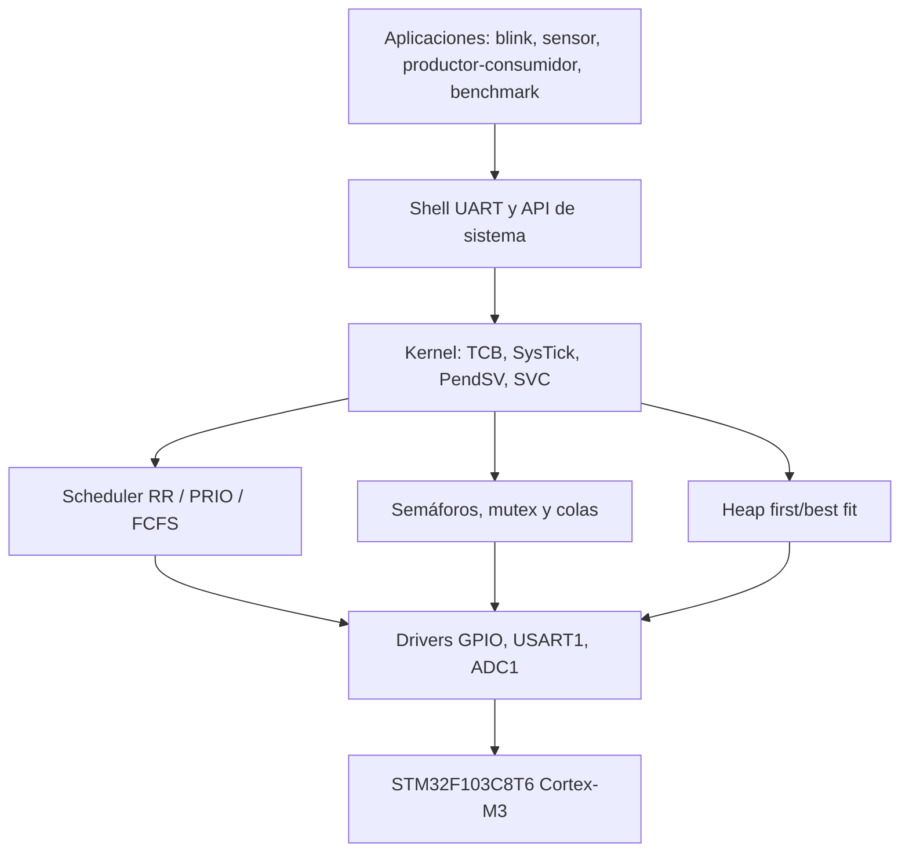
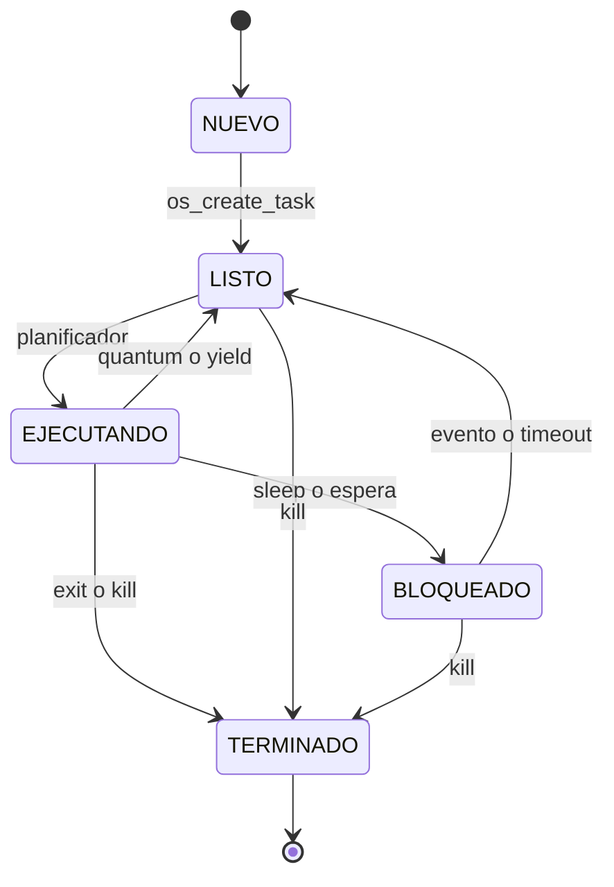

# Diseño del kernel MI-SO para STM32F103C8T6

## Capas

## Cambio de contexto: ARM Cortex-M3

1. **SysTick (1 ms)** incrementa el tiempo, los contadores CPU y despierta tareas dormidas; solicita PendSV.
2. Cuando termina el manejo de interrupciones de mayor prioridad, **PendSV** obtiene el `PSP` de la tarea desalojada. El hardware ya guardó `R0-R3`, `R12`, `LR`, `PC`, `xPSR`.
3. `PendSV_Handler` salva `R4-R11` en esa misma pila de tarea y guarda el nuevo `PSP` como **primer campo del TCB**.
4. En C, `sched_choose()` decide el siguiente TCB según la política; cambia `LISTO/EJECUTANDO/BLOQUEADO` y escoge la cola.
5. PendSV carga el `PSP` del elegido, restaura `R4-R11` y retorna con `EXC_RETURN`; el hardware restaura los demás registros.
6. La primera tarea se inicia vía **SVC**, que restaura un frame artificial compatible con el mecanismo de excepción.

La pila del kernel/interrupciones usa **MSP**; las tareas usan **PSP**. Los TCB y pilas no se copian entre tareas. Para esta versión, las tareas conservan privilegio de ejecución; no existe aislamiento de memoria.

## PCB y estados

Estructura `os_tcb_t` en `src/kernel/os.h`: `sp`, `stack_base`, `ticks_cpu`, `wake_tick`, `entry`, `next`, `wait_next`, `wait_obj`, `woken_from`, `held`, `name`, `id`, `priority`, `state`, `quantum_left`, `wait_kind`, `wake_reason`, `end_reason`, `hold`, `kill_pending`.

Campos para la terminación segura:

- `woken_from`: lista de espera de la que se despertó la tarea, hasta que vuelva a comprobar el recurso.
- `held`: lista de mutex que posee.
- `hold`: recursos retenidos; si es mayor que 0, `kill` se difiere.
- `kill_pending`: hay un `kill` diferido.

## Comparación de políticas

| Modo | Selección | Expropiación |
|---|---|---|
| `rr` | FIFO, quantum configurable en ticks | Sí, al agotar quantum |
| `prio` | Menor valor de prioridad primero | Sí, si llega prioridad mayor; RR entre iguales |
| `fcfs` | FIFO, ejecuta hasta bloquear/terminar/ceder explícitamente | No por tiempo |

## Memoria y límites

- Flash: `0x08000000`, longitud de 64 KB; RAM: `0x20000000`, longitud de 20 KB (linker).
- Stack de cada tarea: 160 palabras × 4 bytes = 640 bytes (10 ranuras: 6400 bytes).
- Heap independiente: 4096 bytes, first-fit o best-fit, fusión de bloques contiguos.
- Reserva para MSP y handlers: linker exige al menos 2 KB libres por encima de `.bss`.
- Canary en la base de la pila por tarea. La detección puede llegar tarde ante sobrescrituras graves; no sustituye un MPU/guard page.

## Terminación segura (`kill`)

- Una tarea con un mutex, o entre `sem_wait_hold` y `sem_signal_release`, no muere de inmediato: `os_kill` devuelve `OS_KILL_DEFERRED` y termina al soltar todos sus recursos. Si nunca los suelta, el `kill` queda pendiente.
- Si muere una tarea recién despertada, el aviso pasa a la siguiente en espera.
- Si termina por `os_exit` o por pila dañada, sus mutex se entregan al siguiente (los datos protegidos pueden quedar a medias). Los semáforos que retenía no se devuelven.

## Relación con libros

| Módulo | Silberschatz, *Operating System Concepts* (10.ª ed.) | Stallings, *Operating Systems* (9.ª ed.) | Tanenbaum, *Modern Operating Systems* (4.ª ed.) |
|---|---|---|---|
| TCB, estados, contexto | Procesos y planificación, caps. 3–5 | Procesos/hilos, caps. 3–4 | Procesos/hilos, cap. 2 |
| Round Robin, prioridad, FCFS | Planificación de CPU, cap. 5 | Planificación uniprocesador, cap. 9 | Planificación, cap. 2 |
| Semáforo, mutex, productor-consumidor | Herramientas de sincronización, caps. 6–7 | Concurrencia e interbloqueo, caps. 5–6 | Comunicación entre procesos, cap. 2 |
| Heap/fragmentación | Memoria principal, cap. 9 | Gestión de memoria, cap. 7 | Administración de memoria, cap. 3 |
| Interrupciones y E/S | Sistemas de E/S, cap. 12 | Gestión de E/S, cap. 11 | Entrada/salida, cap. 5 |

## Comparación con FreeRTOS

FreeRTOS soporta muchos puertos, prioridades configurables, colas complejas, temporizadores y una API madura. MI-SO se enfoca en demostrar el mecanismo de guardado/restauración del contexto y los principios teóricos. La versión presente **no tiene MPU, herencia de prioridad ni temporizadores de software** y no está certificada para sistemas de seguridad o tiempo real duro.

### Documentación técnica base

- STMicroelectronics: **DS5319** para STM32F103x8/B (datos eléctricos, memoria y pinout).
- STMicroelectronics: **RM0008** (registros GPIO, RCC, ADC y USART1).
- STMicroelectronics: **PM0056** (Cortex-M3, excepciones, MSP/PSP, SysTick, PendSV).
