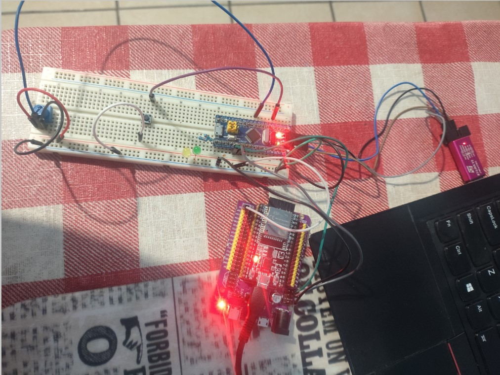
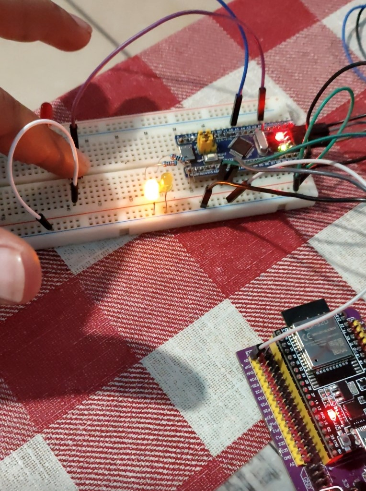
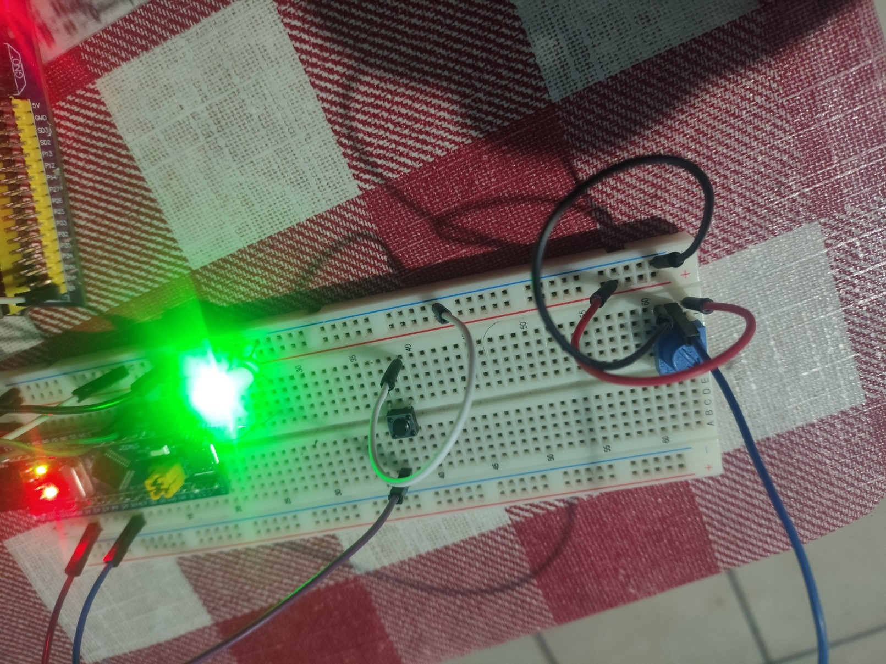
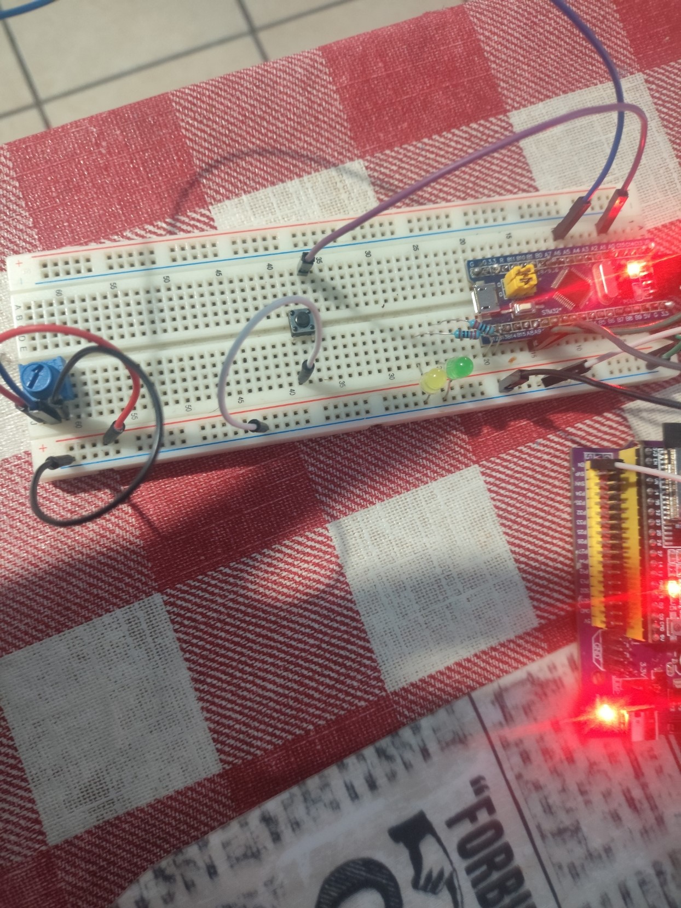

# Reporte final: MI-SO, sistema operativo para STM32F103C8T6

## 1. Introducción

MI-SO v2.0 es un kernel didáctico escrito en C11 y ensamblador ARM Thumb-2 para la placa Blue Pill (STM32F103C8T6, Cortex-M3). No usa ningún RTOS, HAL ni CMSIS. El objetivo fue llevar a hardware real los conceptos de procesos, planificación, sincronización, memoria y E/S estudiados en Silberschatz, Stallings y Tanenbaum.

El sistema se compiló con `arm-none-eabi-gcc` sin advertencias (`-Wall -Wextra -Werror`), se grabó por SWD y se probó en la placa. Las 13 pruebas de hardware resultaron correctas (ver *PRUEBAS.pdf*).

## 2. Cumplimiento de requisitos

| Requisito mínimo | Implementación | Evidencia |
|---|---|---|
| Kernel propio en C y ensamblador | `src/kernel/` con `context.S` y `startup.S` | Código fuente |
| Mínimo 4 tareas con PCB y estados visibles | 7 tareas (idle, shell, prod, cons, blink, button, action) | Comando `ps` |
| Cambio de contexto por temporizador | SysTick de 1 ms y PendSV | Benchmark RR y PRIO |
| Dos algoritmos seleccionables | Tres: Round Robin, prioridades y FCFS | `sched rr/prio/fcfs` |
| Semáforos o mutex en un problema clásico | Productor-consumidor con 2 semáforos y 1 mutex | `run pc` |
| Gestor de memoria propio | Heap de 4096 bytes, first-fit y best-fit | `mem`, `memtest`, `memfit` |
| Shell serie con al menos 5 comandos | 13 comandos | `help` |
| Demostración física con varias tareas | Botón, potenciómetro y 3 LEDs | Fotos, sección 7 |

Valor agregado incluido: modo de bajo consumo (`wfi` en la tarea idle) y porcentaje de CPU por tarea (columna `CPU%` de `ps`).

## 3. Arquitectura del hardware y su uso por el SO

| Recurso | Uso en MI-SO |
|---|---|
| Flash 64 KB en `0x08000000` | Código y constantes: 10 520 bytes de `.text` |
| SRAM 20 KB en `0x20000000` | `.data` 4 bytes y `.bss` 11 448 bytes: 10 pilas de 640 bytes, heap de 4096 bytes y PCB |
| Registros R0–R12, LR, PC, xPSR | Forman el contexto de cada tarea |
| MSP y PSP | MSP para kernel e interrupciones; PSP para cada tarea |
| SysTick | Interrupción cada 1 ms (reloj HSI de 8 MHz, recarga 7999) |
| PendSV (prioridad mínima) | Cambio de contexto diferido, después de las demás interrupciones |
| SVC | Arranque de la primera tarea |
| NVIC y USART1 | Recepción de la consola por interrupción en un buffer circular |
| GPIO y ADC1 | LEDs PC13, PB12 y PB13; botón PA0; potenciómetro en PA5 (canal 5) |

El linker (`linker/stm32f103c8.ld`) limita la memoria a 64 KB y 20 KB y exige al menos 2 KB libres para la pila MSP.

## 4. Decisiones de diseño y fundamento teórico

### 4.1 Procesos y PCB
Cada tarea tiene un PCB (`os_tcb_t`) con ID, nombre, estado, prioridad, apuntador de pila, ticks de CPU y datos de espera, como describen Silberschatz (cap. 3), Stallings (cap. 3) y Tanenbaum (cap. 2). Se usan los cinco estados clásicos: nuevo, listo, ejecutando, bloqueado y terminado.

**Decisión:** los registros no se guardan dentro del PCB sino en la pila de cada tarea, y el PCB solo guarda el apuntador. Así el cambio de contexto copia lo mínimo y aprovecha que el Cortex-M3 apila 8 registros por hardware.

### 4.2 Cambio de contexto
SysTick cuenta el tiempo y solicita PendSV. PendSV guarda R4–R11 en la pila de la tarea, llama al planificador en C y restaura la siguiente tarea. Corresponde al cambio de contexto por interrupción descrito en Silberschatz (cap. 3) y Stallings (cap. 3).

**Decisión:** PendSV tiene la prioridad más baja para no interrumpir otras interrupciones a la mitad; es la misma técnica que usa FreeRTOS en Cortex-M.

### 4.3 Planificación
| Algoritmo | Decisión | Fundamento |
|---|---|---|
| Round Robin | Quantum configurable en ticks (`sched rr N`) | Silberschatz cap. 5; Stallings cap. 9; Tanenbaum cap. 2 |
| Prioridades | Expropiativo; RR entre tareas de igual prioridad | Mismos capítulos; riesgo de inanición |
| FCFS | No expropiativo: la tarea corre hasta bloquearse o terminar | Efecto convoy |

### 4.4 Sincronización y comunicación
Se implementaron semáforos contadores, mutex con dueño y tiempo límite, y una cola de mensajes (Silberschatz caps. 6–7, Stallings caps. 5–6, Tanenbaum cap. 2). El productor-consumidor usa el esquema clásico de buffer acotado:
- `empty` (semáforo, valor inicial 4): lugares libres.
- `full` (semáforo, valor inicial 0): datos listos.
- `lock` (mutex): exclusión mutua sobre el buffer.

La cola de mensajes comunica a la tarea `button` con la tarea `action`.

**Decisión:** las esperas son bloqueantes, no activas: la tarea pasa a BLOQUEADO y no gasta CPU. `kill` sobre una tarea que tiene un mutex se difiere hasta que lo suelte, para no dejar el recurso tomado para siempre.

### 4.5 Memoria
El heap propio de 4096 bytes divide el área en bloques con un encabezado (tamaño y si está ocupado) y permite first-fit o best-fit, con fusión de bloques libres contiguos para reducir la fragmentación externa (Silberschatz cap. 9, Stallings cap. 7, Tanenbaum cap. 3).

**Decisión:** las pilas son estáticas y separadas del heap, para que un error en el heap no dañe una pila. Cada pila tiene un canario en su base que se revisa en cada tick, y una marca de agua mide su uso máximo (`PILA_MAX`).

### 4.6 Drivers, llamadas al sistema y shell
Los drivers (GPIO, USART1 y ADC1) ofrecen funciones simples como `led_set`, `button_read`, `uart_write` y `adc_read`. Las tareas usan la API del kernel (`os_create_task`, `os_sleep`, `os_yield`, `sem_wait`, `sem_signal`, `mutex_lock`, `mq_send`, `mem_alloc`...). Corresponde a E/S en Silberschatz cap. 12, Stallings cap. 11 y Tanenbaum cap. 5.

**Limitación:** la API son funciones de C que corren con privilegio; la separación entre usuario y kernel es de software, no de hardware (no se usa la MPU).

## 5. Resultados

### 5.1 Comparación de planificadores
Dos tareas de 30 ms de CPU cada una (A con prioridad 5, B con prioridad 4; un número menor indica mayor prioridad). Valores medidos en la placa, idénticos en 3 repeticiones:

| Algoritmo | Respuesta A / B (ms) | Espera A / B (ms) | Retorno A / B (ms) | Espera promedio | Respuesta promedio |
|---|---|---|---|---:|---:|
| RR, quantum 5 | 0 / 5 | 30 / 30 | 60 / 60 | 30 | 2.5 |
| RR, quantum 20 | 0 / 20 | 20 / 30 | 50 / 60 | 25 | 10 |
| Prioridades | 30 / 0 | 30 / 0 | 60 / 30 | 15 | 15 |
| FCFS | 0 / 30 | 0 / 30 | 30 / 60 | 15 | 15 |

**Análisis:**
- **Round Robin** da la mejor respuesta (2.5 ms en promedio), pero la peor espera y el peor retorno: ambas tareas terminan al final porque se turnan.
- **Al subir el quantum** de 5 a 20 ms, RR se parece más a FCFS: la respuesta empeora y la espera mejora.
- **Prioridades** atiende primero a B, aunque llegó después. Si siempre hubiera tareas de mayor prioridad, A podría sufrir inanición.
- **FCFS** tiene la misma espera promedio que prioridades en esta prueba, pero B espera los 30 ms completos de A (efecto convoy). Con una tarea larga primero, el efecto sería mayor.

### 5.2 Sincronización
Con `run pc` medido dos veces, los producidos subieron de 2341 a 2472 y los consumidos de 2337 a 2468: ambos +131, con el buffer siempre en 4 de 4. La diferencia entre producidos y consumidos nunca superó el tamaño del buffer, lo que confirma que los semáforos detienen al productor cuando el buffer está lleno. Además, una prueba en PC ejecutó 7200 escenarios de semáforos, colas, mutex y `kill` sin errores.

### 5.3 Memoria
`memtest` reserva tres bloques (80, 112 y 80 bytes) y los libera en otro orden. Al terminar, el heap queda con 0 bytes usados y un solo bloque libre de 4088 bytes, lo que prueba que no hay fugas y que la fusión funciona. Ninguna pila superó 232 de 640 bytes y todos los canarios quedaron intactos.

## 6. Comparación con RTOS comerciales

| Aspecto | MI-SO | FreeRTOS | Zephyr |
|---|---|---|---|
| Objetivo | Didáctico | RTOS ligero para microcontroladores | SO completo para dispositivos embebidos e IoT |
| Planificación | RR, prioridades o FCFS, elegibles en ejecución | Prioridades expropiativo, con reparto por tiempo opcional | Prioridades; hilos cooperativos y expropiativos |
| Sincronización | Semáforos, mutex con tiempo límite y cola | Semáforos, mutex con herencia de prioridad, colas, grupos de eventos | Semáforos, mutex con herencia de prioridad, colas, FIFOs y más |
| Memoria | 1 heap first/best-fit | Varios esquemas de heap (heap_1 a heap_5) o memoria estática | Varios asignadores, incluidos heaps y bloques de tamaño fijo |
| Desbordamiento de pila | Canario y marca de agua | Comprobación opcional de desbordamiento | Protección con MPU o canarios |
| Protección de memoria | No | Opcional con MPU | Modo usuario con MPU |
| Plataformas | 1 placa | Decenas de arquitecturas | Cientos de placas |
| Extras | Shell propia | Temporizadores de software y bibliotecas adicionales | Redes, Bluetooth, sistemas de archivos, devicetree |

**Coincidencias:** MI-SO usa el mismo mecanismo de SysTick, PendSV y SVC que el puerto de FreeRTOS para Cortex-M, y el mismo esquema de PCB, colas de listos y listas de espera.

**Diferencias:** los RTOS comerciales agregan herencia de prioridad (evita la inversión de prioridad), temporizadores de software, protección por MPU, soporte para muchas plataformas y años de pruebas en producción. MI-SO no los tiene y no es apto para sistemas críticos.

**Ventaja de MI-SO:** su código es pequeño y se puede leer completo, por lo que sirve para entender lo que un RTOS comercial hace internamente.

## 7. Demostración física

## 8. Problemas encontrados y soluciones

| Problema | Solución |
|---|---|
| El linker no ubicaba `.ARM.exidx` y `.data` no tenía dirección de carga en Flash | Se corrigió `stm32f103c8.ld` |
| El potenciómetro en PA1 daba lecturas sin sentido | El problema estaba en el cableado de 3.3 V; además se cambió la entrada a PA5 |
| PB13 parpadeaba cerca del valor intermedio por ruido del ADC | Histéresis: enciende con 2150 o más y apaga con 1950 o menos |
| No había adaptador USB-TTL | Se usó un ESP32 con EN a GND como puente USB-serie |
| `kill` podía dejar un mutex tomado | Terminación diferida hasta liberar los recursos |

## 9. Conclusiones

1. Se construyó un kernel funcional que cumple los ocho requisitos mínimos, con evidencia medida en la placa.
2. El cambio de contexto resultó más sencillo de lo esperado en Cortex-M3, porque el hardware guarda la mitad de los registros; lo difícil fue garantizar que nada se interrumpa a la mitad de una operación del kernel.
3. Las mediciones confirmaron la teoría: Round Robin mejora la respuesta a cambio de más espera y más retorno, y FCFS y prioridades favorecen a una tarea en perjuicio de la otra.
4. La sincronización requirió más cuidado que la planificación: casos como terminar una tarea que tiene un recurso solo se encontraron con pruebas repetidas.
5. Comparado con FreeRTOS y Zephyr, MI-SO cubre el núcleo de un RTOS, pero le faltan herencia de prioridad, protección de memoria y madurez. Para un producto real convendría usar un RTOS comercial; para aprender, construirlo desde cero muestra lo que esos sistemas resuelven.

## 10. Referencias

1. Silberschatz, A., Galvin, P. B. y Gagne, G. *Operating System Concepts*, 10.ª ed. Wiley, 2018.
2. Stallings, W. *Operating Systems: Internals and Design Principles*, 9.ª ed. Pearson, 2018.
3. Tanenbaum, A. S. y Bos, H. *Modern Operating Systems*, 4.ª ed. Pearson, 2015.
4. STMicroelectronics. *RM0008: Reference manual STM32F101xx, STM32F102xx, STM32F103xx...*
5. STMicroelectronics. *PM0056: STM32F10xxx/20xxx/21xxx/L1xxxx Cortex-M3 programming manual*.
6. STMicroelectronics. *DS5319: STM32F103x8, STM32F103xB datasheet*.
7. Documentación oficial de FreeRTOS (freertos.org) y de Zephyr Project (docs.zephyrproject.org).
